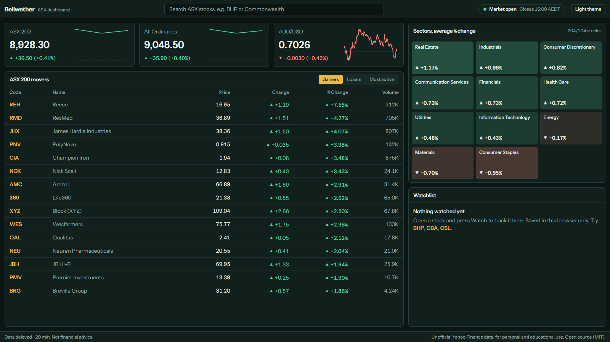

# Meridian - market dashboard

An open-source, no-login market dashboard for the ASX, US, UK, Europe, Japan and Hong Kong. It runs on one screen (built for 1600x900), has navy dark and light themes (it follows your system setting until you pick one with the header toggle), and keeps your dashboards in your own browser.



## Features

- **Markets** - tabs for ASX, US, UK, Europe, Japan and Hong Kong (`/?region=us`). Each shows three index or FX tiles with an intraday sparkline, movers and a sector heatmap.
- **Movers** - tabs for Gainers, Losers and Most active (ranked by traded value, ignoring very thinly traded lines) across hand-maintained lists: `data/asx200.ts` for the ASX and `data/markets.ts` for the rest.
- **Sector heatmap** - average % change per GICS sector.
- **Stock detail** (`/stock/BHP`, `/stock/AAPL.US`, `/stock/VOD.L`, `/stock/7203.T`; ASX codes stay bare) - price and volume chart with 1D, 5D, 1M, 6M, YTD, 1Y and 5Y ranges; key stats (market cap, P/E, dividend yield, 52-week range, volume vs average, sector); recent news; Pin button.
- **Search** - type a company name or code; results cover every supported market and show which exchange each is on.
- **Market status** - open/closed badge for the market you are viewing, from each exchange's local hours and lunch breaks (public holidays are modelled for the ASX only). For the ASX it is computed for 10:00-16:00 `Australia/Sydney` on weekdays using `Intl` (correct across AEST/AEDT). National ASX holidays (with substitute days) show "Closed - holiday name", and Christmas Eve and New Year's Eve close early at 14:10. Quotes auto-refresh every 60 seconds, only while the relevant market is open.
- **Dashboards** (`/dashboard`) - make tabs of pinned stocks from any market, rename, reorder and delete them. Each pin shows price, change and an intraday sparkline. Stored in `localStorage`; nothing is sent to a server. An older watchlist is moved into a "Watchlist" dashboard automatically.
- **News** (`/news`) - each market's main index plus gold, oil, the US 10-year yield, VIX and bitcoin; recent market headlines filterable by market, each tagged with the stocks Yahoo links to it and their move today; and a ranking of the most-named stocks. Being named in a story does not mean the story caused the move.
- Gains and losses use green and red plus arrows and +/- signs, so colour is never the only signal.

## Stack

Next.js (App Router, TypeScript), Tailwind CSS, Recharts, [`yahoo-finance2`](https://github.com/gadicc/yahoo-finance2) (server-side only, from `app/api/*` route handlers), Vitest. No database: an in-memory TTL cache (60s for quotes, 10 minutes for long-range history, 5 minutes for news and search) keeps Yahoo traffic low.

## Setup

Requires Node 20+ (developed on Node 24).

```bash
npm install
npm run dev        # http://localhost:3000
```

Other commands:

```bash
npm run build           # production build
npm start               # serve the production build
npm test                # unit tests (market hours, cache, aggregation helpers)
npm run lint
npm run verify-tickers  # check every ticker in data/asx200.ts resolves on Yahoo
npm run verify-tickers -- --prune   # ...and delete the ones that do not
```

No environment variables are required. `.env.example` lists optional cache-lifetime overrides.

### API routes

| Route | Purpose |
| --- | --- |
| `/api/overview?region=us` | index/FX quotes with intraday sparkline data (default `au`) |
| `/api/quotes?symbols=BHP.AX,CBA.AX` | batched quotes (max 60 symbols) |
| `/api/movers?region=us` | gainers, losers, most active and sector averages (default `au`) |
| `/api/stock/[code]` | quote, key stats and sector (`BHP`, `AAPL.US`, `VOD.L`) |
| `/api/sparks?symbols=BHP.AX,AAPL` | intraday close points (max 40 symbols) |
| `/api/global` | main index per market plus gold, oil, US 10-year, VIX, bitcoin |
| `/api/market-news?region=all` | market headlines with tagged tickers, their quotes and mention counts |
| `/api/chart?symbol=BHP.AX&range=1M` | price and volume history |
| `/api/news?code=BHP` | recent headlines for one stock |
| `/api/search?q=toyota` | search across supported markets |

Errors come back as JSON `{ error, message }` with an appropriate status (400, 404, 429 for upstream rate limits, 502 for upstream failures), and the UI shows a message with a Retry button instead of crashing.

## About the stock lists

`data/asx200.ts` and `data/markets.ts` are hand-maintained, approximate snapshots (see the as-of dates in the files), not official index memberships. Run `npm run verify-tickers` after editing it.

## Disclaimer

Market data comes from Yahoo Finance through an unofficial, undocumented API. It can be delayed by about 20 minutes, incomplete, wrong, or stop working at any time. This project is for personal and educational use only. **Nothing here is financial advice.** It is not affiliated with or endorsed by any exchange or by Yahoo. Check Yahoo's terms of use before deploying it publicly.

## Licence

MIT, copyright 2026 faithrf. See [LICENSE](LICENSE).
